# DESIGN AND IMPLEMENTATION OF A WEB-BASED GPS LOCATION TRACKING AND MANAGEMENT SYSTEM FOR NYANZA DISTRICT

<style>
body {
  font-family: "Times New Roman", Times, serif;
  font-size: 14pt;
  line-height: 1.5;
}

p, li, td, th {
  font-family: "Times New Roman", Times, serif;
  font-size: 14pt;
}

h1, h2, h3, h4, h5, h6 {
  font-family: "Times New Roman", Times, serif;
}
</style>

**A final-year thesis submitted to the University of Lay Adventists of Kigali (UNILAK) in partial fulfilment of the requirements for the award of the Bachelor of Science degree in Computing and Information Sciences**

**Student:** [Student Name]  
**Registration Number:** [Registration Number]  
**Supervisor:** [Supervisor Name]  
**Campus:** Nyanza Campus  
**Academic Year:** [Academic Year]

---

# DEDICATION

This work is dedicated to my parents, family members, lecturers, and friends whose encouragement, patience, and moral support enabled me to complete this academic project. It is also dedicated to students and public-service practitioners who seek practical and affordable ways of using information technology to improve the management of mobile activities in their communities.

# DECLARATION

I, **[Student Name]**, declare that this thesis entitled **“Design and Implementation of a Web-Based GPS Location Tracking and Management System for Nyanza District”** is my original work and has not been submitted to any other institution for the award of an academic qualification. All sources used in this work have been acknowledged through appropriate citations and references.

**Student signature:** ____________________  
**Date:** ____________________

# ACKNOWLEDGMENT

I thank God for the strength and guidance that enabled me to complete this study. I sincerely thank my supervisor, **[Supervisor Name]**, for the academic direction, constructive comments, and continuous support provided during the development of this thesis. I am grateful to the lecturers and staff of the University of Lay Adventists of Kigali for the knowledge and skills acquired throughout my programme.

I also appreciate the support of my classmates, friends, and family members. Their encouragement assisted me during the requirements analysis, implementation, testing, and preparation of this document. Finally, I acknowledge the public information made available by Nyanza District and the Government of Rwanda, which helped to establish the institutional and geographical context of this study.

# TABLE OF CONTENT

**Front matter**

- Dedication
- Declaration
- Acknowledgment
- Table of Content
- List of Figures
- List of Symbols & Abbreviations
- Abstract

**Chapter 1: Introduction**

- 1.1 Background to the study
- 1.2 Problem statement
- 1.3 Objectives
  - 1.3.1 General objective
  - 1.3.2 Specific objectives
- 1.4 Significance
  - 1.4.1 Personal
  - 1.4.2 Institutional
  - 1.4.3 Public interest
- 1.5 Scope of the study
- 1.6 Expected results
- 1.7 Organization of the study

**Chapter 2: Literature Review**

- 2.1 Introduction
- 2.2 Definitions
  - 2.2.1 Key concepts of the topic
  - 2.2.2 IT concepts
- 2.3 Comparative study of similar systems
- 2.4 Personal contribution

**Chapter 3: Analysis of Existing System**

- 3.1 Introduction
- 3.2 Organization overview
- 3.3 Vision, mission and development objectives
- 3.4 Description of existing system activities
  - 3.4.1 Tracker registration
  - 3.4.2 Location reporting
  - 3.4.3 Trip monitoring
  - 3.4.4 Trip reporting and record keeping
- 3.5 Weaknesses of the existing system
- 3.6 Proposed solutions

**Chapter 4: Analysis & Design of New System**

- 4.1 Introduction
- 4.2 Development methodologies, models and tools
- 4.3 Function diagram
- 4.4 Context diagram
- 4.5 Data flow diagram (level 0)
- 4.6 Functional and non-functional requirements
- 4.7 Database design
  - 4.7.1 Entities
  - 4.7.2 Relationships and cardinality
  - 4.7.3 Attributes
  - 4.7.4 Physical model
  - 4.7.5 Logical model
  - 4.7.6 Data dictionary
  - 4.7.7 Supporting design diagrams

**Chapter 5: Implementation of the New System**

- 5.1 Introduction
- 5.2 Implementation environment
- 5.3 Server-side implementation
- 5.4 Account registration and authentication implementation
- 5.5 REST API implementation
- 5.6 Database implementation
- 5.7 Dashboard implementation
- 5.8 Smartphone tracker implementation
- 5.9 Trip reporting and distance calculation
- 5.10 Map and route implementation
- 5.11 Application workflow
- 5.12 Deployment and operation
- 5.13 Working-system screenshots
- 5.14 Implementation summary

**Chapter 6: References**

# LIST OF FIGURES

- **Figure 3.1:** Existing tracker registration process
- **Figure 3.2:** Existing location reporting process
- **Figure 3.3:** Existing trip monitoring process
- **Figure 3.4:** Existing trip reporting and record-keeping process
- **Figure 4.1:** Function diagram of the proposed GPS management system
- **Figure 4.2:** Context diagram of the proposed GPS management system
- **Figure 4.3:** Level 0 data flow diagram
- **Figure 4.4:** Entity relationship diagram
- **Figure 4.5:** System architecture diagram
- **Figure 4.6:** Location-update sequence diagram
- **Figure 4.7:** Tracking activity diagram
- **Figure 4.8:** Deployment diagram
- **Figure 5.1:** First-run administrator account setup screen
- **Figure 5.2:** Administrator sign-in screen
- **Figure 5.3:** Authenticated management dashboard
- **Figure 5.4:** Dashboard showing live tracker locations and telemetry
- **Figure 5.5:** Route-history table showing recorded GPS points
- **Figure 5.6:** Smartphone tracker location-permission prompt
- **Figure 5.7:** Smartphone tracker transmitting live coordinates
- **Figure 5.8:** Dashboard with a selected tracker and route history
- **Figure 5.9:** Sign-in validation error screen
- **Figure 5.10:** Additional authenticated dashboard view

# LIST OF SYMBOLS & ABBREVIATIONS

| Symbol or abbreviation | Meaning |
|---|---|
| API | Application Programming Interface |
| BSc | Bachelor of Science |
| DBMS | Database Management System |
| DFD | Data Flow Diagram |
| ERD | Entity Relationship Diagram |
| GPS | Global Positioning System |
| HTML | HyperText Markup Language |
| HTTP | HyperText Transfer Protocol |
| HTTPS | HyperText Transfer Protocol Secure |
| JSON | JavaScript Object Notation |
| NISR | National Institute of Statistics of Rwanda |
| OOM | Object-Oriented Methodology |
| REST | Representational State Transfer |
| SQL | Structured Query Language |
| UNILAK | University of Lay Adventists of Kigali |
| UML | Unified Modeling Language |

# ABSTRACT

This study presents the design and implementation of a web-based GPS location tracking and management system for Nyanza District. The study responds to the difficulty of obtaining timely, centralized, and reliable information about the location and movement of field personnel, mobile teams, or vehicles when monitoring depends on telephone calls, informal messages, and manually maintained records. The proposed system uses a smartphone browser as a low-cost GPS tracking device. The browser requests location permission, captures latitude, longitude, speed, accuracy, and time, and sends the data to a central web server. An administrator accesses a web dashboard to register trackers, view the latest locations on an interactive map, inspect location history, and manage trips.

The system was designed using object-oriented analysis principles and UML-oriented modelling. The implementation uses HTML, CSS, and JavaScript for the client interface, Node.js and Express for the application server, SQLite for relational data storage, and Leaflet with OpenStreetMap for map visualization. The completed system also implements local account registration, first-run administrator setup, password hashing with scrypt, signed seven-day sessions, temporary login lockout, administrator and viewer roles, password recovery through a command-line utility, trip reporting, distance calculation, and authenticated dashboard access. The source code, release package, screenshots, and implementation documentation are maintained in the project repository at https://github.com/MiracleCodez/gps-system. The system is intended as a practical, deployable solution that can be used and demonstrated without owning a car or purchasing a dedicated GPS unit, because a smartphone carried by a walking user can simulate the movement of a vehicle or field team.

The expected contribution is a transparent, affordable, and extensible platform for location monitoring. The implemented access-control layer protects the management dashboard while allowing the smartphone tracker to submit valid field observations. Further production hardening would include external security review, stronger secret management, database backups, privacy policies, audit logging, and testing with district stakeholders. The completed system therefore provides both a working operational application and a documented technical basis for future expansion.

**Keywords:** GPS, location tracking, fleet management, smartphone geolocation, authentication, trip reporting, web application, Nyanza District, information system.

# CHAPTER 1: INTRODUCTION

## 1.1 Background to the study

The management of mobile activities depends on knowing where people, vehicles, or field teams are located and whether they are following planned activities. In a district environment, such information can support coordination of field visits, inspection activities, public-service operations, transport, emergency response, and other tasks that require movement between locations. When location information is available only through telephone calls or informal messages, managers cannot easily obtain a shared and historical view of activity.

A Global Positioning System (GPS) receiver determines a device’s position by processing signals from navigation satellites. Modern smartphones combine GPS capability with mobile connectivity and web browsers. A smartphone can therefore collect location coordinates and transmit them to a server without the installation of a dedicated vehicle tracker. This approach is suitable for the implemented system because it reduces hardware cost and allows a walking user to simulate the movement of a vehicle or field worker.

Nyanza District is one of the eight districts in Rwanda’s Southern Province. The official district profile describes it as a historical and cultural centre of Rwanda and states that it is composed of 10 sectors, 51 cells, and 420 villages. The district’s economic activities include agriculture, livestock, trade, and tourism [1]. These administrative and economic characteristics create a context in which timely information about mobile activities can be valuable for coordination and service delivery.

The transport sector is also relevant to the study. Rwanda’s Ministry of Infrastructure identifies transport responsibilities that include government fleet management and traffic management. The ministry further emphasizes mobility, accessibility, reliability, safety, monitoring, and evaluation of transport services [2]. A small web-based tracking system cannot address all national transport requirements, but it can demonstrate how digital location records may support monitoring and reporting at an operational level.

The study is academically conducted at the University of Lay Adventists of Kigali. UNILAK’s official profile states that the university has a Nyanza Campus and that its mission includes education, scientific and technological research, and community service [3]. The proposed system is therefore aligned with a computing research project that applies software development skills to a practical district-level problem.

## 1.2 Problem statement

The problem addressed by this study is the absence of a simple and affordable platform for centralized GPS location monitoring in the selected Nyanza District context. In a manual or decentralized arrangement, a field user may communicate a location by telephone or message, while a supervisor records the information in a notebook, spreadsheet, or separate communication thread. Such an arrangement does not provide a continuously updated map, consistent timestamps, automated history, or a reliable method of comparing activities over time.

The absence of centralized location records can lead to delayed decision-making, incomplete trip histories, difficulty verifying reported movements, and additional administrative work. It also limits the ability of a manager to view several trackers from one interface. Dedicated vehicle GPS systems may solve some of these problems, but they introduce hardware, installation, subscription, and maintenance costs that are not appropriate for an initial BSc implementation.

This study therefore proposes a smartphone-based web system that captures GPS coordinates, stores them in a relational database, and displays the information on a management dashboard. The project uses a smartphone as the tracking device, so the researcher does not need to own a car or dedicated tracking hardware to demonstrate the system.

## 1.3 Objectives

### 1.3.1 General objective

To design and implement a web-based GPS location tracking and management system for Nyanza District.

### 1.3.2 Specific objectives

1. To examine the existing methods used for registering, communicating, monitoring, and recording mobile activities in the selected study context.
2. To identify the functional and non-functional requirements of a smartphone-based GPS management system.
3. To design the system architecture, process models, database structure, and user interfaces of the proposed system.
4. To implement a smartphone tracking interface that requests location permission and transmits GPS coordinates to a web server.
5. To implement an administrative dashboard for tracker registration, map-based monitoring, telemetry inspection, and route-history review.
6. To implement a relational database for storing trackers, location points, and trip records.
7. To test the system using functional, integration, validation, and usability-oriented test cases.

## 1.4 Significance

### 1.4.1 Personal

The study enables the researcher to apply software engineering knowledge to a complete information-system project. It provides practical experience in requirements analysis, object-oriented modelling, REST API development, database design, web programming, browser geolocation, map visualization, testing, and technical documentation. The project also creates a foundation for future research into geofencing, route optimization, spatial databases, and mobile applications.

### 1.4.2 Institutional

For UNILAK, the project provides an applied computing case study connected to community service and technological research. It may support teaching and demonstration in systems analysis, web development, database management, and information systems. The project can also be extended by future students who wish to add authentication, PostgreSQL/PostGIS, analytics, notifications, or dedicated GPS-device integration.

### 1.4.3 Public interest

A low-cost location-management system may be useful to public institutions, small transport operators, delivery teams, non-governmental organizations, and community-service programmes that cannot immediately purchase dedicated tracking infrastructure. The system may improve visibility of mobile activities and reduce dependence on fragmented communication. However, location data is sensitive; public deployment must therefore include consent, access control, data minimization, secure transmission, and clear retention rules.

## 1.5 Scope of the study

The geographical context of the study is Nyanza District in Rwanda. The academic and development context is UNILAK, particularly the Nyanza Campus and the computing discipline. The system scope is a web-based GPS location tracking and management system.

Functionally, the system covers tracker registration, smartphone geolocation permission, transmission of latitude and longitude, storage of speed and accuracy, latest-location display, tracker status, trip start and end, and route-history review. The system includes a dashboard for an administrator or fleet manager and a phone tracker page for the field user.

The system does not include vehicle engine diagnostics, fuel sensors, dedicated GPS hardware, automatic emergency dispatch, payment processing, facial recognition, national-scale public transport planning, or production-grade multi-tenant security. These areas are identified as possible future extensions rather than current deliverables.

## 1.6 Expected results

The study is expected to produce a working web application through which a smartphone can act as a GPS tracking device. The system should allow an administrator to register a tracker and view the tracker’s latest position on an interactive map. It should store valid location points in a relational database and provide a history that can be reviewed after movement has taken place.

The study is also expected to produce a documented system design comprising requirements, process diagrams, a context diagram, a level 0 data-flow diagram, a function diagram, an entity relationship diagram, a logical data model, a physical database model, and a data dictionary. Finally, the study should provide test evidence showing whether the implemented functions satisfy the specified requirements.

## 1.7 Organization of the study

Chapter One introduces the study by presenting its background, problem, objectives, significance, scope, expected results, and organization. Chapter Two reviews key concepts and compares similar categories of systems. Chapter Three analyses the existing processes considered in the study context, identifies their weaknesses, and proposes solutions. Chapter Four presents the development methodology and the design of the proposed system, including the function diagram, context diagram, data-flow diagram, requirements, and database design.

# CHAPTER 2: LITERATURE REVIEW

## 2.1 Introduction

This chapter reviews concepts related to GPS location tracking, district administration, mobility management, and information systems. It defines the main terms used in the study, explains the information-technology concepts that support the proposed solution, compares similar system categories, and identifies the contribution of the present study.

## 2.2 Definitions

### 2.2.1 Key concepts of the topic

**District.** A district is a local administrative area established to organize public administration and the delivery of services. In this study, Nyanza District refers to the district in Rwanda’s Southern Province that includes sectors, cells, and villages under a decentralized administrative structure. The official district profile states that Nyanza has 10 sectors, 51 cells, and 420 villages [1].

**GPS.** The Global Positioning System is a satellite-based positioning system that enables a receiver to estimate its geographical position. In this study, GPS refers to the location capability available on a smartphone and accessed through the browser’s geolocation interface.

**Location coordinate.** A location coordinate is a numeric representation of position, normally expressed as latitude and longitude. The system also records time, speed, and estimated accuracy for each coordinate observation.

**Tracker.** A tracker is a registered device that submits location information to the system. In the implemented system, the tracker is normally a smartphone browser. The design also allows the concept to represent a future dedicated GPS device.

**Fleet management.** Fleet management is the coordination, monitoring, and administration of vehicles or mobile assets. In this study, the term is used broadly to include the management of registered trackers, trips, positions, and operational history. The implemented system is not limited to vehicles and can represent field workers or other mobile teams.

**Trip.** A trip is a period of movement that begins when the user selects “Start trip” and ends when the user selects “End trip”. A trip is associated with one tracker and may contain many location records.

**Geofencing.** Geofencing is the creation of a virtual geographic boundary that can trigger an event when a tracker enters or leaves an area. Geofencing is not implemented in the current MVP but is a relevant future extension.

**Route history.** Route history is the ordered collection of location points recorded for a tracker. The dashboard displays these points as a table and can connect them as a route line on the map.

**Real-time monitoring.** Real-time monitoring is the observation of recent system events with a short delay between data collection and display. In this implemented system, the tracker sends updates when the browser reports a new position and the dashboard refreshes recent device data periodically.

### 2.2.2 IT concepts

**Information.** Information is data that has been processed or organized so that it has meaning for a user. A latitude value alone is data; a map marker labelled with the tracker name, time, speed, and status is information useful for management.

**Software.** Software is a collection of programs, configuration, and related files that instruct a computing device to perform tasks. The GPS system includes server software, browser-side scripts, stylesheets, database initialization logic, and configuration files.

**System.** A system is a set of connected components that interact to achieve a purpose. The proposed system contains users, a smartphone tracker, browser pages, an API, validation logic, a database, and a map interface.

**Information system.** An information system is an organized combination of people, procedures, data, hardware, software, and communication resources used to collect, process, store, and distribute information. The proposed GPS system is an information system because it transforms location observations into operational information for a manager.

**Database.** A database is an organized collection of related data that can be stored, queried, updated, and protected. The implemented system uses SQLite to store devices, locations, and trips.

**Application Programming Interface.** An API is a defined interface through which software components exchange requests and responses. The system’s REST API receives location submissions and returns device, location, and trip information as JSON.

**Web application.** A web application is software accessed through a web browser and supported by server-side processing. The proposed system has a dashboard page and a phone tracker page served by the Express web server.

**User interface.** A user interface is the visible and interactive part of a system through which a person performs tasks. The dashboard provides map, device, telemetry, and history controls, while the tracker page provides tracking and trip controls.

## 2.3 Comparative study of similar systems

The proposed system can be compared with four broad categories of existing solutions. Dedicated vehicle GPS platforms usually provide continuous tracking, hardware integration, geofencing, driver behaviour analysis, and alerts. Their main disadvantage for this study is the cost and complexity of purchasing, installing, and maintaining dedicated hardware.

Mobile fleet applications use smartphone location services and often provide route monitoring, driver communication, proof of delivery, and reports. They are closer to the proposed solution because they use a phone as the tracking device. However, many commercial applications are subscription-based and may include features that are unnecessary for a small BSc implementation.

Manual reporting systems use telephone calls, messaging applications, paper forms, or spreadsheets. They require little technical infrastructure, but they do not provide consistent real-time visibility, automatic coordinate validation, or a unified route history. They also create additional work when a supervisor needs to compare multiple activities.

Public mapping platforms provide map visualization and routing but do not necessarily provide a complete management workflow. The proposed system combines the map interface with tracker registration, location persistence, trip records, and an administrative dashboard. Its distinctive contribution is therefore not the invention of GPS or maps; it is the integration of accessible smartphone geolocation with a small, understandable management system that can be demonstrated without a vehicle.

| System category | Tracking device | Central history | Map dashboard | Hardware cost | Suitability for this study |
|---|---|---:|---:|---:|---|
| Dedicated fleet platform | Installed GPS unit | Yes | Yes | High | Useful as a reference, costly for this implementation |
| Commercial mobile fleet app | Smartphone | Yes | Usually | Subscription | Similar concept, less transparent for study |
| Manual calls and spreadsheets | Phone or paper | Fragmented | No | Low | Current-problem reference |
| Proposed GPS system | Smartphone browser | Yes | Yes | Low | Appropriate for the BSc system |

The comparison indicates that the proposed system occupies a practical middle ground. It provides more structure than manual reporting while avoiding the hardware requirements of a dedicated fleet platform. The implemented system should not be evaluated as equivalent to mature commercial products in uptime, security, or large-scale analytics.

## 2.4 Personal contribution

The personal contribution of this study is the design and implementation of an end-to-end smartphone-based GPS information system adapted to the Nyanza District context. The work combines requirements analysis, process modelling, object-oriented thinking, database design, REST API implementation, browser geolocation, and map visualization in one coherent implemented system.

The study also contributes a low-cost demonstration method. Because the smartphone itself acts as the tracking device, the researcher can walk with the phone and generate a realistic route without owning a car. This makes the system accessible for academic demonstration while preserving the essential data flow of a vehicle or field-team tracking system.

# CHAPTER 3: ANALYSIS OF EXISTING SYSTEM

## 3.1 Introduction

This chapter analyses the existing process considered by the study before the introduction of the proposed web-based system. Since no formal district workflow records or interview transcripts were supplied for this draft, the existing activities are modelled as a manual or semi-manual location-reporting arrangement. Before final submission, the researcher should validate these descriptions through interviews, observation, questionnaires, or official process documents and replace any assumption that does not match the selected department or organization.

The analysis focuses on four activities: tracker registration, location reporting, trip monitoring, and trip reporting. Each activity is described with a process figure so that the transition from the existing arrangement to the proposed system is clear.

## 3.2 Organization overview

Nyanza District is located in Rwanda’s Southern Province and is one of the province’s eight districts. According to its official profile, the district is historically and culturally significant, contains 10 sectors, 51 cells, and 420 villages, and has economic activities that include agriculture, livestock, trade, and tourism [1]. These characteristics mean that district operations may involve coordination across multiple administrative and physical locations.

The academic host institution for this study is the University of Lay Adventists of Kigali. UNILAK’s official profile states that the university was established by the Federation of Adventist Parents Associations for the Development of Education in Rwanda and that it operates campuses in Kigali, Nyanza, and Rwamagana. The profile also identifies education, scientific and technological research, and community service as central institutional purposes [3].

For this study, Nyanza District is the application context, while UNILAK provides the academic setting in which the system is analysed and developed. The system is not claimed to be an officially commissioned district information system. It is an academic system designed to demonstrate how a district-level organization could centralize location monitoring.

## 3.3 Vision, mission and development objectives

The official Nyanza District profile presents the district as a historical and cultural centre and describes a development focus involving cultural tourism and sustainable development [1]. In the context of this study, the relevant operational vision is a district administration supported by timely, reliable, and accessible information for coordinating mobile activities.

The relevant mission for the proposed system is to support coordination and accountability by making recent location information available to authorized users through a centralized web interface. This system mission is consistent with the national transport emphasis on mobility, accessibility, reliability, safety, monitoring, and evaluation [2].

The development objectives of the proposed system are to reduce reliance on fragmented communication, centralize location records, improve visibility of active trackers, support trip documentation, and provide a technical foundation for future alerts and spatial analysis.

## 3.4 Description of existing system activities

### 3.4.1 Tracker registration

In the assumed existing arrangement, a new vehicle, phone, or field user is identified through a conversation between an administrator and a supervisor. Basic information may be written in a notebook, spreadsheet, or message thread. The assignment of the device to a user or route is then communicated informally.

This procedure can be adequate for a small number of users, but it does not create one authoritative tracker register. Names, device identifiers, assignments, and status changes may be stored in different places. Figure 3.1 shows the process model used for this study.


*Figure 3.1: Existing tracker registration process.*

### 3.4.2 Location reporting

In the assumed existing arrangement, a field user travels and communicates a location only when a supervisor requests an update or when the user considers it necessary. The supervisor records the reported location and time manually. If no update is requested, the movement may not create a central record.

This procedure depends on availability of the user and supervisor, accuracy of verbal descriptions, and consistency of manual recording. Figure 3.2 presents the process.


*Figure 3.2: Existing location reporting process.*

### 3.4.3 Trip monitoring

Trip monitoring in the assumed existing arrangement depends on a starting communication, periodic verbal updates, and follow-up when a delay or incident is reported. The supervisor does not continuously see the position on a map. Monitoring therefore depends on the frequency and quality of communication.

Figure 3.3 illustrates this manual monitoring process. The repeated follow-up loop indicates why a centralized recent-location view could reduce unnecessary communication and improve situational awareness.


*Figure 3.3: Existing trip monitoring process.*

### 3.4.4 Trip reporting and record keeping

After a trip, the supervisor collects calls, messages, and paper notes and attempts to compare reported times and locations. A summary report may then be prepared and filed or shared with management. Because the information is collected from separate sources, historical analysis can be difficult and the completeness of the report depends on the quality of the records received.

Figure 3.4 shows the assumed process for trip reporting and record keeping.


*Figure 3.4: Existing trip reporting and record-keeping process.*

## 3.5 Weaknesses of the existing system

The existing arrangement has limited centralization. Tracker information and location updates may be distributed across notebooks, spreadsheets, phone calls, and messaging platforms. This makes it difficult to maintain a single current register.

The arrangement also provides limited real-time visibility. A supervisor can know the location only after a user communicates it. If the user is unavailable, busy, or experiencing connectivity problems, the supervisor may not receive an update. The system therefore cannot reliably show the latest position of every mobile user.

Manual records can contain inconsistent names, missing timestamps, imprecise place descriptions, and duplicated entries. It is also difficult to draw a route from text messages or to calculate the distance and time travelled without additional processing.

The current arrangement does not automatically validate coordinates because it usually records descriptions rather than latitude and longitude. It also does not provide a standard method for showing whether a tracker is online, offline, or stale.

Finally, manual reporting increases administrative workload. A supervisor must request updates, transcribe information, compare records, and prepare summaries. The arrangement may also expose sensitive location information through uncontrolled communication channels.

## 3.6 Proposed solutions

The proposed system introduces a centralized tracker register containing the tracker name, type, status, and creation time. This replaces dispersed identification records with a database record that can be queried by the dashboard and API.

The smartphone tracker page uses browser geolocation to capture latitude, longitude, speed, accuracy, and time. It sends the observation to the server as a structured JSON request. The server validates the device and geographic ranges before storing the point in the locations table.

The dashboard provides a map-based view of latest locations and automatically refreshes recent device information. A manager can select a tracker to inspect its coordinates, speed, accuracy, last-seen time, and historical route. This reduces dependence on repeated phone calls and creates a consistent record for review.

The trip functions provide explicit start and end events. A trip is associated with the tracker and can be queried later. This creates a foundation for future reports, distance calculations, route-deviation alerts, and performance analysis.

The proposed system does not remove the need for human judgment or field communication. It provides a complementary digital record. In a production setting, it should be combined with user consent, secure authentication, retention controls, and procedures for responding to inaccurate or unavailable location data.

# CHAPTER 4: ANALYSIS & DESIGN OF NEW SYSTEM

## 4.1 Introduction

This chapter presents the analysis and design of the proposed web-based GPS location tracking and management system. It describes the development methodology, modelling approach, tools, functions, system boundary, data flows, requirements, and database design. The design is based on a smartphone tracker, a web dashboard, an Express API, and a relational SQLite database.

## 4.2 Development methodologies, models and tools

### 4.2.1 Unified Process

The study adopts the Unified Process as a guiding software-development framework. The Unified Process is iterative and incremental. Its phases are inception, elaboration, construction, and transition. During inception, the problem and project scope are defined. During elaboration, requirements, architecture, and risks are analysed. During construction, the API, database, tracker interface, and dashboard are implemented. During transition, the system is tested, documented, and prepared for demonstration.

The use of iterations is appropriate because the project contains technical uncertainty around browser geolocation, network access, map rendering, and data persistence. A basic vertical slice can be built first: one smartphone submits one location and the dashboard displays it. Additional capabilities such as trips, history, and device registration can then be added without changing the entire design.

### 4.2.2 Unified Modeling Language

Unified Modeling Language (UML) is used to communicate the structure and behaviour of the system. The function diagram presents the main functional decomposition. The context diagram presents external actors and the system boundary. The data-flow diagram shows movement of information between processes and data stores. The ERD presents the database entities and their relationships. Together, the models create a traceable connection between requirements, implementation, and data storage.

### 4.2.3 Object-Oriented Methodology

Object-Oriented Methodology (OOM) analyses a system in terms of objects, their data, and their responsibilities. In this system, important objects include Device, Location, Trip, TrackerClient, Dashboard, and ApiService. A Device has an identity and status. A Location belongs to a Device and records a geospatial observation. A Trip belongs to a Device and represents a period of movement. The object-oriented perspective supports modular code and makes it easier to extend the system with users, geofences, alerts, or maintenance records.

### 4.2.4 Development tools

The client interface uses HTML, CSS, and JavaScript. The server uses Node.js and Express.js. SQLite is used as the relational database for the implemented system. Leaflet.js renders interactive map markers and route lines, while OpenStreetMap provides map tiles. Git and GitHub provide version control. Mermaid source files are used for diagrams, and the system can be run with `npm install` followed by `npm start`.

## 4.3 Function diagram

The function diagram decomposes the proposed system into tracker management, location tracking, trip management, and monitoring/reporting. Tracker management registers and selects devices. Location tracking requests permission, captures coordinates, validates observations, and stores them. Trip management creates and completes trip records. Monitoring and reporting provide the map, telemetry, and route history used by the administrator.


*Figure 4.1: Function diagram of the proposed GPS location tracking and management system.*

## 4.4 Context diagram

The context diagram shows the proposed system as one central process and identifies the two primary external actors. The administrator or fleet manager sends tracker and monitoring requests and receives map, status, telemetry, and history information. The smartphone tracker user grants permission, starts or stops tracking, and starts or ends trips. The system receives location data from the tracker and provides stored information to the administrator.


*Figure 4.2: Context diagram of the proposed GPS location tracking and management system.*

## 4.5 Data flow diagram (level 0)

The level 0 data-flow diagram decomposes the system into tracker management, location capture, and fleet monitoring. The administrator interacts with tracker management and receives monitoring outputs. The smartphone tracker provides coordinates and trip actions to the location-capture process. Validated location points are stored in the locations data store, while device and trip information are stored in their respective data stores.


*Figure 4.3: Level 0 data-flow diagram of the proposed GPS location tracking and management system.*

## 4.6 Functional and non-functional requirements

### 4.6.1 Functional requirements

| Requirement ID | Functional requirement |
|---|---|
| FR-01 | The system shall allow an administrator to register a tracker with a name and device type. |
| FR-02 | The system shall list all registered trackers. |
| FR-03 | The phone tracker shall request browser location permission before tracking. |
| FR-04 | The phone tracker shall capture latitude, longitude, speed, accuracy, and time. |
| FR-05 | The system shall submit location observations to the server through a REST API. |
| FR-06 | The server shall validate the tracker identifier and coordinate ranges. |
| FR-07 | The server shall store valid location observations in the database. |
| FR-08 | The dashboard shall display latest tracker positions on an interactive map. |
| FR-09 | The dashboard shall display tracker status and last-seen time. |
| FR-10 | The administrator shall view the history of a selected tracker. |
| FR-11 | The user shall start a trip for a tracker. |
| FR-12 | The user shall end an active trip. |
| FR-13 | The administrator shall view recorded trip information. |
| FR-14 | The system shall provide first-run setup for the first administrator account. |
| FR-15 | The system shall allow a registered user to sign in and sign out. |
| FR-16 | The system shall hash passwords before storing them in SQLite. |
| FR-17 | The system shall support administrator and read-only viewer roles. |
| FR-18 | The system shall temporarily block repeated failed login attempts from one address. |
| FR-19 | The system shall allow a viewer account to be created after administrator setup. |
| FR-20 | The system shall calculate and display trip duration, distance, point count, and status. |
| FR-21 | The system shall show distinct tracker marker colours, labels, and selected-marker emphasis on the map. |

### 4.6.2 Non-functional requirements

| Requirement ID | Non-functional requirement |
|---|---|
| NFR-01 | The system shall provide a responsive interface usable on a laptop and smartphone. |
| NFR-02 | The API shall reject invalid latitude and longitude values. |
| NFR-03 | The system shall preserve location and trip records after a server restart. |
| NFR-04 | The dashboard shall refresh recent device information automatically. |
| NFR-05 | The interface shall display understandable errors for denied permission and failed requests. |
| NFR-06 | The deployment shall use HTTPS when accessed from a physical phone outside localhost. |
| NFR-07 | The system should use parameterized database statements to reduce injection risk. |
| NFR-08 | Production deployment shall restrict access to authorized users and protect personal location data. |
| NFR-09 | Passwords shall not be stored as plain text. |
| NFR-10 | Authenticated sessions shall expire after seven days. |
| NFR-11 | The system shall provide understandable feedback for invalid credentials, duplicate accounts, and temporary lockout. |
| NFR-12 | The system should remain sufficiently simple for installation and demonstration in a BSc environment. |

## 4.7 Database design

### 4.7.1 Entities

The database contains five implemented tables. The **User** entity represents an account that can access the system. The **Setting** entity stores application-level configuration such as the generated session secret. The **Device** entity represents a registered smartphone or future GPS device. The **Location** entity represents one position observation submitted by a device. The **Trip** entity represents a period of movement associated with a device.

The design intentionally separates users, devices, locations, and trips. User records support authentication and authorization without repeating account data in operational records. A device can submit many observations over time, while each observation belongs to one device. This structure avoids repeating device names and types in every location record. Trips are also separated because a device may complete many trips, and a trip may be analysed independently of the device’s entire history.

### 4.7.2 Relationships and cardinality

The relationship between Device and Location is one-to-many. One device can produce zero, one, or many location records. Every location record must belong to exactly one device. The relationship between Device and Trip is also one-to-many. One device can have zero, one, or many trips, and every trip must belong to exactly one device. The User and Setting tables are independent support tables: users are resolved by the signed session token, while settings store application configuration.

The foreign key `locations.device_id` references `devices.id`. The foreign key `trips.device_id` references `devices.id`. Cascade deletion is used in the implemented system so that deleting a device also removes dependent location and trip records. A production system should apply deletion policies carefully because location history may be subject to legal, operational, or audit requirements.

### 4.7.3 Attributes

A User has `id`, `name`, `email`, `password_hash`, `role`, and `created_at`. A Setting has `key` and `value`. A Device has `id`, `name`, `device_type`, `status`, and `created_at`. A Location has `id`, `device_id`, `latitude`, `longitude`, `speed`, `accuracy`, and `recorded_at`. A Trip has `id`, `device_id`, `started_at`, `ended_at`, and `status`.

The `id` fields uniquely identify records. `latitude` and `longitude` represent position. `speed` represents speed in kilometres per hour in the client payload. `accuracy` represents the approximate accuracy reported by the browser in metres. ISO-formatted timestamps provide a consistent representation of time.


*Figure 4.4: Entity relationship diagram of the proposed GPS location tracking and management system.*

### 4.7.4 Physical model

The physical model is implemented in SQLite. The database contains the tables `users`, `settings`, `devices`, `locations`, and `trips`. The `users`, `devices`, `locations`, and `trips` identifiers are integer primary keys generated automatically. The fields that store names, emails, roles, types, statuses, configuration values, and timestamps use text values. Passwords are stored as scrypt-derived hashes rather than plain text. Geographic measurements use real-number fields.

The physical schema also creates an index on `(device_id, recorded_at DESC)` in the locations table. This index supports the common query that retrieves recent location points for a selected device. Foreign-key enforcement is enabled. The standalone implementation schema is included in `docs/database-schema.sql`.

```sql
CREATE TABLE users (
  id INTEGER PRIMARY KEY AUTOINCREMENT,
  name TEXT NOT NULL,
  email TEXT NOT NULL UNIQUE COLLATE NOCASE,
  password_hash TEXT NOT NULL,
  role TEXT NOT NULL DEFAULT 'viewer',
  created_at TEXT NOT NULL DEFAULT CURRENT_TIMESTAMP
);

CREATE TABLE settings (
  key TEXT PRIMARY KEY,
  value TEXT NOT NULL
);

CREATE TABLE devices (
  id INTEGER PRIMARY KEY AUTOINCREMENT,
  name TEXT NOT NULL,
  device_type TEXT NOT NULL DEFAULT 'smartphone',
  status TEXT NOT NULL DEFAULT 'offline',
  created_at TEXT NOT NULL DEFAULT CURRENT_TIMESTAMP
);

CREATE TABLE locations (
  id INTEGER PRIMARY KEY AUTOINCREMENT,
  device_id INTEGER NOT NULL,
  latitude REAL NOT NULL,
  longitude REAL NOT NULL,
  speed REAL DEFAULT 0,
  accuracy REAL,
  recorded_at TEXT NOT NULL,
  FOREIGN KEY (device_id) REFERENCES devices(id) ON DELETE CASCADE
);

CREATE TABLE trips (
  id INTEGER PRIMARY KEY AUTOINCREMENT,
  device_id INTEGER NOT NULL,
  started_at TEXT NOT NULL,
  ended_at TEXT,
  status TEXT NOT NULL DEFAULT 'active',
  FOREIGN KEY (device_id) REFERENCES devices(id) ON DELETE CASCADE
);
```

### 4.7.5 Logical model

The logical model can be represented as follows:

`USERS (id, name, email, password_hash, role, created_at)`

`SETTINGS (key, value)`

`DEVICES (id, name, device_type, status, created_at)`

`LOCATIONS (id, device_id, latitude, longitude, speed, accuracy, recorded_at)`

`TRIPS (id, device_id, started_at, ended_at, status)`

The primary key of `USERS` is `id`, with a case-insensitive unique constraint on `email`. The primary key of `SETTINGS` is `key`. The primary key of `DEVICES` is `id`. The primary key of `LOCATIONS` is `id`, and `device_id` is a foreign key referencing `DEVICES.id`. The primary key of `TRIPS` is `id`, and `device_id` is a foreign key referencing `DEVICES.id`. The logical model is normalized sufficiently for the implemented system because account and device details are not repeated in location or trip rows and each field stores one principal value.

### 4.7.6 Data dictionary

| Entity | Attribute | Data type | Key or rule | Description |
|---|---|---|---|---|
| User | id | INTEGER | Primary key, auto-increment | Unique account identifier |
| User | name | TEXT | Required | Account holder’s display name |
| User | email | TEXT | Required, unique, case-insensitive | Sign-in and account identifier |
| User | password_hash | TEXT | Required | Scrypt-derived password representation |
| User | role | TEXT | Admin or viewer | Authorization level |
| User | created_at | TEXT | Default timestamp | Account creation time |
| Setting | key | TEXT | Primary key | Configuration name |
| Setting | value | TEXT | Required | Configuration value, including the session secret |
| Device | id | INTEGER | Primary key, auto-increment | Unique identifier of a tracker |
| Device | name | TEXT | Required | Human-readable tracker name |
| Device | device_type | TEXT | Default: smartphone | Type of tracking device |
| Device | status | TEXT | Default: offline | Current derived status |
| Device | created_at | TEXT | Default timestamp | Time at which tracker was registered |
| Location | id | INTEGER | Primary key, auto-increment | Unique location record |
| Location | device_id | INTEGER | Foreign key, required | Device that submitted the point |
| Location | latitude | REAL | -90 to 90 | North/south coordinate |
| Location | longitude | REAL | -180 to 180 | East/west coordinate |
| Location | speed | REAL | Default: 0 | Speed associated with the point in km/h |
| Location | accuracy | REAL | Optional | Estimated GPS accuracy in metres |
| Location | recorded_at | TEXT | Required timestamp | Time at which the point was recorded |
| Trip | id | INTEGER | Primary key, auto-increment | Unique trip record |
| Trip | device_id | INTEGER | Foreign key, required | Device assigned to the trip |
| Trip | started_at | TEXT | Required timestamp | Time at which the trip began |
| Trip | ended_at | TEXT | Optional | Time at which the trip ended |
| Trip | status | TEXT | Active or completed | Current state of the trip |

### 4.7.7 Supporting design diagrams

The architecture diagram shows the separation between browser clients, the Express application server, REST routes, and SQLite storage. The sequence diagram traces a location update from the phone browser to the database and back to the dashboard. The activity diagram presents the tracking workflow, while the deployment diagram shows local and managed-host operation.

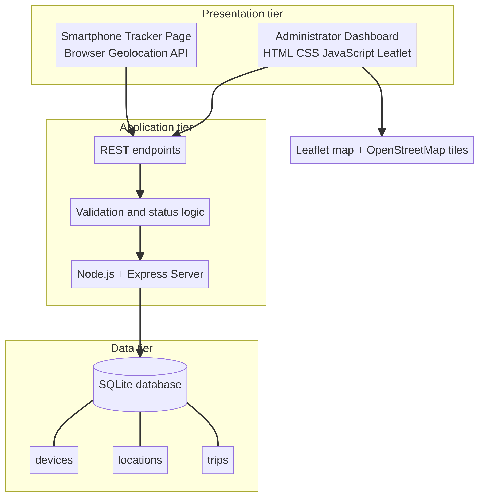

*Figure 4.5: Three-tier system architecture of the GPS location tracking and management system.*

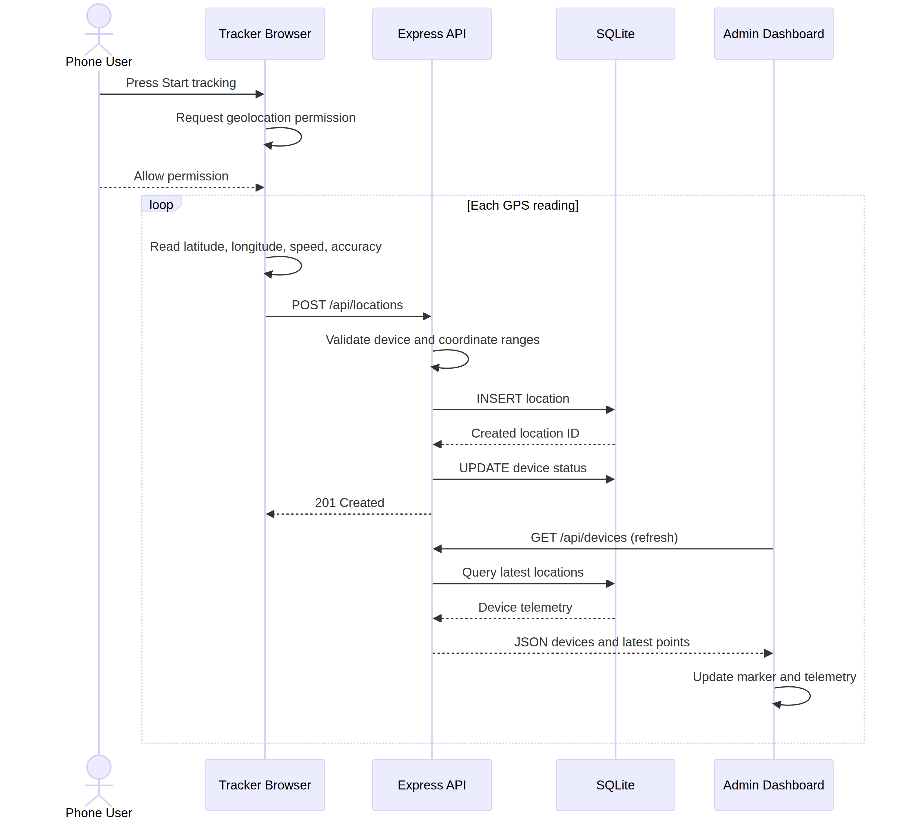

*Figure 4.6: Sequence of a smartphone location update.*

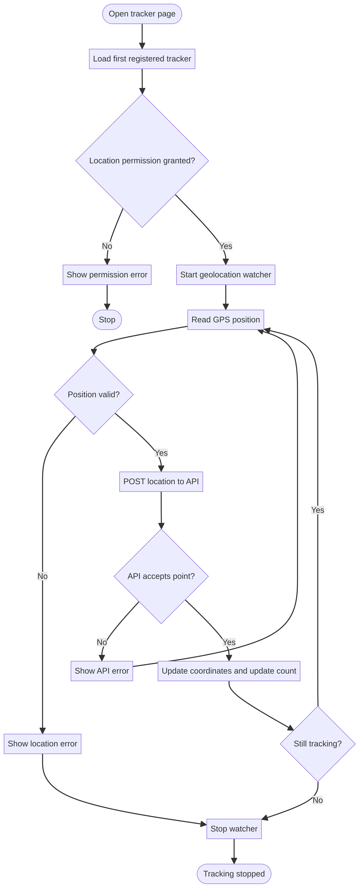

*Figure 4.7: Activity flow for starting tracking, sending positions, and ending a trip.*

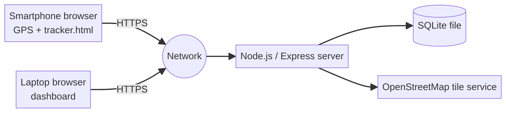

*Figure 4.8: Deployment view for local and hosted operation.*

**Sources cited in this draft:** [1] Nyanza District, “About Nyanza District,” official district website, https://www.nyanza.gov.rw/en/district/about-the-district. [2] Ministry of Infrastructure, Rwanda, “Transport,” https://www.mininfra.gov.rw/1/transport. [3] University of Lay Adventists of Kigali, “UNILAK Profile,” https://site.unilak.ac.rw/elementor-1875/.


# CHAPTER 5: IMPLEMENTATION OF THE NEW SYSTEM

## 5.1 Introduction

This chapter describes the implementation of the working web-based GPS location tracking and management system. The implementation translates the analysis and design presented in Chapter Four into an operational client-server application. The final system comprises a first-run account setup and authentication module, an administrator and viewer access model, a management dashboard, a smartphone tracker interface, an Express application server, a REST API, SQLite persistence, interactive mapping, route history, and trip reporting.

The system remains practical for Nyanza District because a smartphone can act as the tracking device. A manager can monitor the system from a browser while a field user carries the phone and grants location permission. The implementation was maintained in the GitHub repository and the working interface was captured in the screenshots stored in the repository's `screenshots` directory.

## 5.2 Implementation environment

The system was implemented using the following software and technologies:

| Component | Technology used | Implementation purpose |
|---|---|---|
| Client interface | HTML5, CSS3 and JavaScript | Login, dashboard, tracker, tables and feedback |
| Server runtime | Node.js | Execution environment for the application server |
| Web framework | Express.js | HTTP server, routing, authentication endpoints and REST API |
| Database | SQLite through better-sqlite3 | Persistent storage of accounts, devices, locations, trips and settings |
| Password security | Node.js `crypto.scryptSync` | Salted password hashing and verification |
| Session security | HMAC-SHA256 signed cookie | Seven-day authenticated browser session |
| Mapping library | Leaflet.js | Interactive map markers, labels and route visualization |
| Map data | OpenStreetMap | Base map tiles for monitoring |
| Data format | JSON | Communication between browser clients and the REST API |
| Version control | Git and GitHub | Source-code management, releases and thesis evidence |
| Deployment | Docker-compatible Node.js host | Public HTTPS operation and phone geolocation access |

The application is started through the Node Package Manager scripts in `package.json`. The server listens on the configured port, serves the pages and styles in `public`, and exposes the REST API from the same origin. The recovery utility `scripts/create-admin.js` can create an administrator or reset an existing administrator password without storing the password in the source code.

## 5.3 Server-side implementation

The server-side implementation is contained in `server.js`. Express serves static resources and defines the authentication, dashboard, location, and trip routes. At startup, the application creates missing SQLite tables and indexes without deleting existing data. It also seeds a demo tracker and sample points when the device table is empty so that the dashboard can be demonstrated before a physical phone is connected.

The server validates account fields, email format, password length, device identifiers, and coordinate ranges. Parameterized SQL statements are used for database writes and reads. The `requireAuth` middleware protects the dashboard, device list, location-history, and trip-reporting endpoints. The `requireAdmin` middleware protects tracker registration, so a read-only viewer can inspect information without changing the fleet registry.

## 5.4 Account registration and authentication implementation

The final application implements a local account module. On the first run, `/login` displays the **Create admin account** form. The first user provides a name, email, password, and confirmation password. The server permits this setup only while the `users` table is empty and assigns the first account the `admin` role.

After the first administrator exists, the same page becomes a normal sign-in page and provides a viewer-account registration option. New public registrations are assigned the `viewer` role. Administrators can register trackers, while viewers can access authenticated monitoring functions without receiving the tracker-creation permission. The legacy `/auth/login` path redirects to `/login` so previously shared links remain usable.

Passwords are never stored as plain text. The server generates a random salt, derives a 64-byte password hash using `scrypt`, and stores the representation in the `password_hash` field. During login, the entered password is derived with the stored salt and compared with a timing-safe comparison. After successful authentication, the server creates a signed `gps_session` cookie containing the user identifier and an expiry time seven days in the future. The server validates the signature and expiry on each protected request.

The login endpoint applies temporary brute-force protection. Eight failed attempts from the same network address within ten minutes cause the endpoint to return HTTP 429 until the temporary window expires. The `scripts/create-admin.js` utility supports recovery by creating an administrator or updating an existing administrator password. The sign-in interface presents validation errors for incorrect credentials, duplicate emails, mismatched passwords, and temporary lockout.

## 5.5 REST API implementation

The REST API provides communication between the login page, dashboard, smartphone tracker, and server:

| Method | Endpoint | Access and implementation function |
|---|---|---|
| GET | `/api/health` | Public health check for deployment readiness |
| GET | `/api/auth/status` | Reports whether setup is required and whether the browser is authenticated |
| POST | `/api/auth/setup` | Creates the first administrator account |
| POST | `/api/auth/register` | Creates a read-only viewer account after setup |
| POST | `/api/auth/login` | Verifies credentials and creates a session |
| POST/GET | `/api/auth/logout` or `/auth/logout` | Clears the current session |
| GET | `/api/session` | Returns the authenticated user and role |
| GET | `/api/devices` | Authenticated list of trackers and latest locations |
| POST | `/api/devices` | Administrator-only tracker registration |
| GET | `/api/devices/:id/locations` | Authenticated location history for one tracker |
| POST | `/api/locations` | Stores a phone GPS update after coordinate validation |
| POST | `/api/trips/start` | Creates an active trip for a tracker |
| POST | `/api/trips/end` | Completes the active trip |
| GET | `/api/trips` | Returns authenticated trip reports with duration, distance, points and status |

When a phone submits a location, the request contains a device identifier, latitude, longitude, speed, accuracy, and the server-generated recording time. The server verifies the device and coordinate ranges before storing the observation. A successful response confirms that the point was recorded and updates the device status to online.

## 5.6 Database implementation

The final database implementation contains five tables: `users`, `settings`, `devices`, `locations`, and `trips`. The `users` table stores account identity, scrypt password representation, role, and creation time. The `settings` table stores application configuration, including a generated session secret when one is not supplied through the environment. The operational tables preserve tracker identity, coordinate observations, and trip periods.

The one-to-many relationships defined in Chapter Four are implemented through foreign keys. A device can have many location observations and many trips. Each location and trip belongs to one device. The index on `(device_id, recorded_at DESC)` supports the dashboard query for recent tracker history. SQLite is appropriate for the current BSc deployment because it is lightweight and simple to install; a larger multi-department deployment could migrate the logical model to PostgreSQL or another server database.

## 5.7 Dashboard implementation

The management dashboard is implemented in `public/index.html`, `public/app.js`, and `public/styles.css`. It is opened only after successful authentication and displays the signed-in user and role in the header. It contains the following modules:

1. **Account context:** shows the authenticated name and role and provides sign-out.
2. **Tracker registration:** administrators can add a tracker name and device type; viewers do not receive this control.
3. **Fleet registry:** registered trackers are displayed with device type, last-seen time, selected state, and online/offline status.
4. **Live map:** latest tracker positions are shown as colour-coded markers with permanent labels.
5. **Telemetry panel:** the selected tracker displays latitude, longitude, speed, status, device type, creation time, and last-seen information.
6. **Route history:** stored observations are shown as a route line and a tabular list of recorded points.
7. **Trip reporting:** recent trips are shown with tracker, start time, end time, duration, calculated distance, point count, and active/completed status.
8. **Automatic refresh:** device and trip information refreshes periodically so new phone submissions appear without a full page reload.

The later GUI update adds a stable colour from a palette to each tracker, a visible label for each map marker, a highlighted selected marker, and more prominent trip reporting. These details improve interpretation when several trackers are visible at the same time.

## 5.8 Smartphone tracker implementation

The smartphone tracker is implemented in `public/tracker.html` and `public/tracker.js`. When a user opens the page without a valid session, the page detects the unauthorized device-list response and redirects to `/login`. After authentication, the tracker page loads the first registered tracker and displays its identifier and device type.

When tracking starts, the browser requests location permission through the Geolocation API. After permission is granted, the page watches for position changes, extracts latitude, longitude, speed, and accuracy, and sends the data to `/api/locations`. The page presents the latest coordinates, accuracy, update count, connection status, and feedback message. The user can start and end a trip from the same page. Physical-phone operation requires HTTPS or localhost permission, and the screenshots show both the permission prompt and a successful online update.

## 5.9 Trip reporting and distance calculation

Trip reporting was extended beyond simple start and end timestamps. The server retrieves the location points recorded between a trip’s start and end times. It applies the Haversine formula to consecutive coordinate pairs to estimate travelled distance in kilometres. The API returns the trip record together with the number of points and rounded distance.

The dashboard calculates a human-readable duration from the start and end times and displays distance, point count, and status in the recent-trips table. An active trip has no end time and its duration is calculated up to the current time. A completed trip displays its stored end time and final calculated values. This module gives the manager an operational summary instead of requiring manual interpretation of the route table.

## 5.10 Map and route implementation

The mapping component uses Leaflet and OpenStreetMap. The dashboard creates a marker for each tracker with a location, assigns a stable palette colour, attaches the tracker name as a visible label, and updates the marker when a new location arrives. Selecting a tracker changes the marker emphasis and opens the corresponding telemetry and route history.

For route history, the dashboard converts ordered location records into coordinate pairs and draws a polyline through them. The map is fitted to the available route when appropriate. The map remains a presentation layer, while the server and SQLite database preserve the observations. This separation allows the map library or storage engine to be replaced later without changing the essential tracker workflow.

## 5.11 Application workflow

The complete operational workflow is implemented as follows:

1. The user opens `/login`.
2. If no account exists, the user creates the first administrator account; otherwise the user signs in or creates a viewer account.
3. The server hashes the password, creates a signed seven-day session, and redirects the user to the dashboard.
4. The administrator registers a tracker; a viewer can inspect trackers but cannot add one.
5. The phone user opens `/tracker.html` and grants location permission.
6. The smartphone obtains a position and sends a JSON location request.
7. The server validates the device and coordinates, stores the observation, and updates the tracker status.
8. The dashboard refreshes and displays the latest marker, label, telemetry, and route history.
9. The phone user starts and ends a trip.
10. The server calculates trip duration, distance, and point count for the authenticated reporting view.
11. The manager selects a tracker to inspect its history and recent trip records.

This workflow connects the requirements, authentication module, database model, system diagrams, and user interfaces. It also permits demonstration with a walking smartphone user when a vehicle is not available.

## 5.12 Deployment and operation

The application is maintained in the GitHub repository `MiracleCodez/gps-system`. Local operation requires Node.js, dependency installation with `npm install`, and startup with `npm start`. The first-run setup is completed at `http://localhost:3000/login`. If an administrator forgets the password, the documented recovery command is:

```bash
node scripts/create-admin.js "Your Name" you@email.com "NewPassword"
```

For hosted operation, the project uses a Docker-compatible Node.js environment, public HTTPS, a health endpoint, and persistent database storage. HTTPS is important because modern browsers restrict geolocation on insecure origins. The deployment should include database backup, server logs, secret management, and a documented restart procedure before real location data is collected.

## 5.13 Working-system screenshots

The following figures were captured from the working application and committed to the repository in the `screenshots` directory. They provide implementation evidence for the authentication, dashboard, map, history, and smartphone tracking modules.

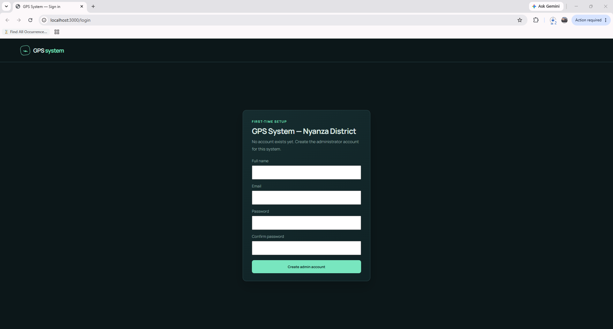

*Figure 5.1: First-run administrator account setup screen showing name, email, password, and confirmation fields.*


*Figure 5.2: Authenticated management dashboard showing the live map, fleet registry, selected tracker, and route-history area.*

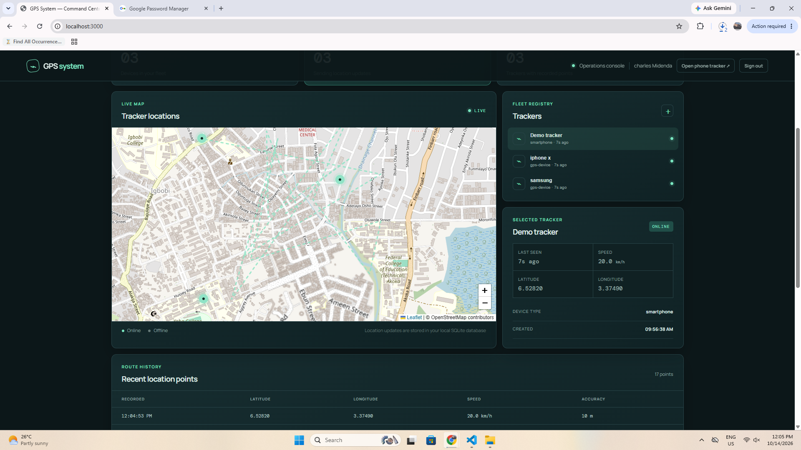

*Figure 5.3: Dashboard map displaying current tracker markers and selected-tracker telemetry.*

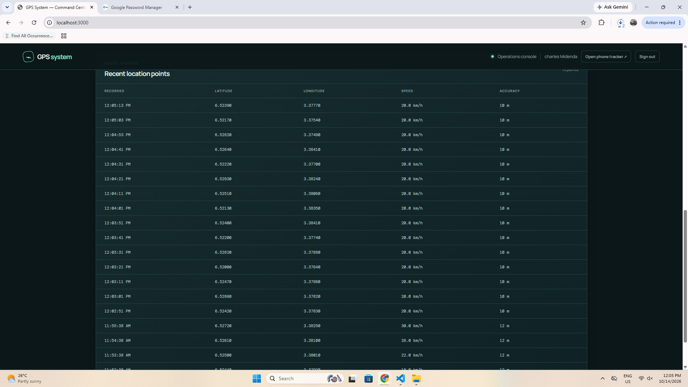

*Figure 5.4: Route-history table showing recorded timestamps, coordinates, speed, and accuracy.*

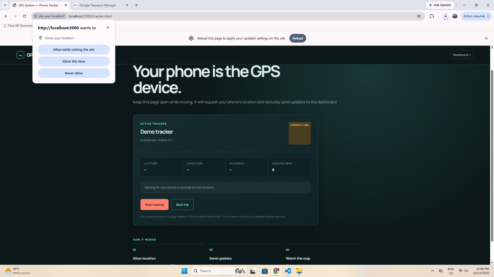

*Figure 5.5: Smartphone tracker interface requesting permission to use the phone’s location.*

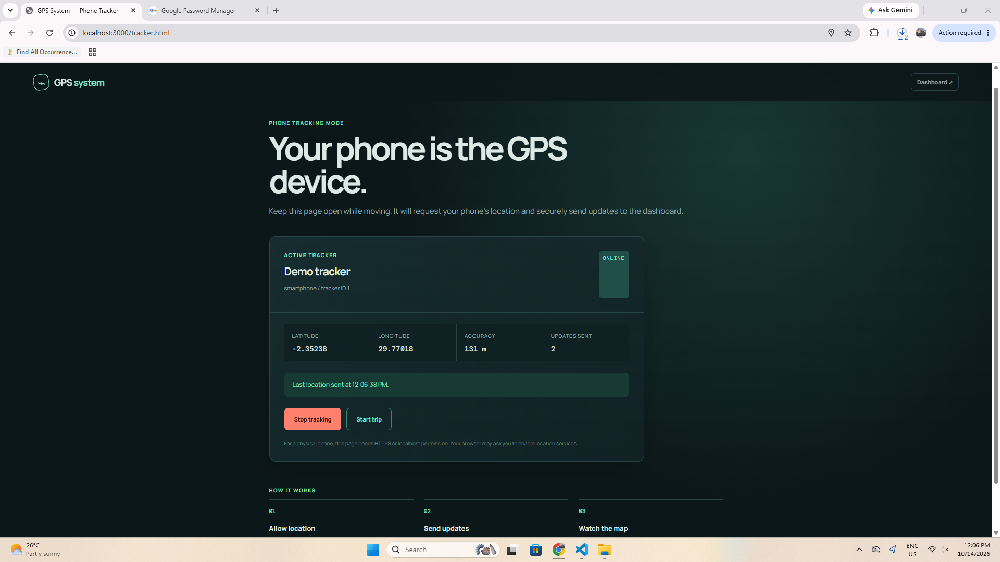

*Figure 5.6: Smartphone tracker after permission is granted and location updates are being sent successfully.*

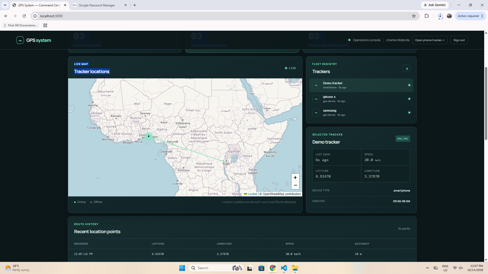

*Figure 5.7: Wide dashboard map view showing the monitoring area and multiple tracker points.*

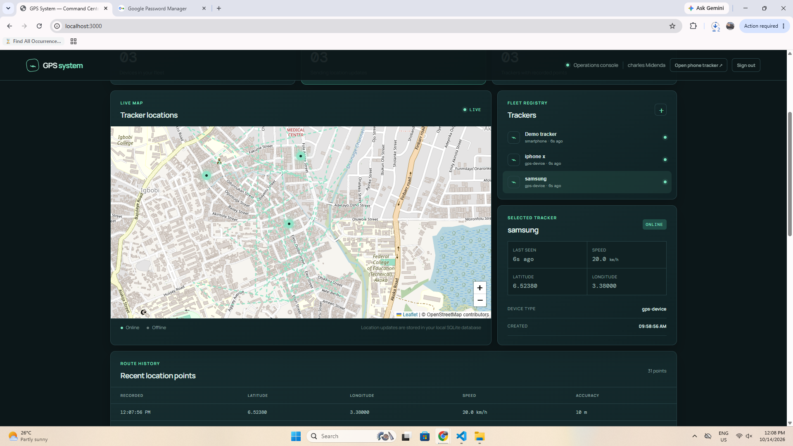

*Figure 5.8: Dashboard with the Samsung tracker selected, showing its device type, position, status, and history.*

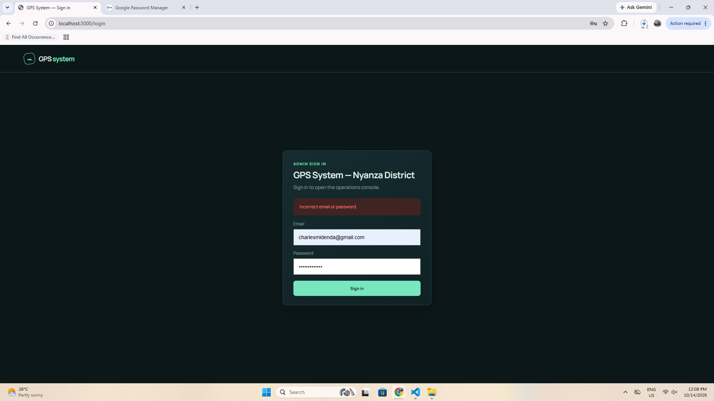

*Figure 5.9: Sign-in validation feedback after an incorrect email or password.*

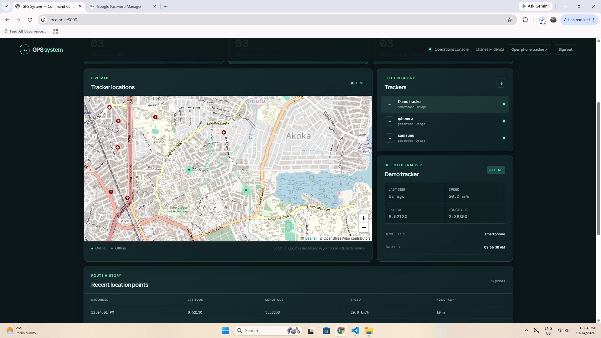

*Figure 5.10: Additional authenticated dashboard view showing the live map, tracker list, telemetry, and recent location points.*

## 5.14 Implementation summary

The final system is a working authenticated web application with first-run administrator setup, viewer registration, signed sessions, scrypt password hashing, temporary login lockout, role-based tracker registration, a smartphone geolocation tracker, REST API, SQLite persistence, interactive map visualization, colour-coded tracker markers, route history, trip distance calculation, and trip reporting. The uploaded screenshots provide evidence of the implemented user interfaces and operational workflow. The system directly reflects the design presented in Chapter Four and can be demonstrated with a smartphone in place of a dedicated GPS device.

# CHAPTER 6: REFERENCES

[1] Nyanza District, “About Nyanza District,” Official Website of Nyanza District, Rwanda. Available at: https://www.nyanza.gov.rw/en/district/about-the-district. Accessed: 10 October 2026.

[2] Ministry of Infrastructure, Rwanda, “Transport,” Official Website of the Ministry of Infrastructure. Available at: https://www.mininfra.gov.rw/1/transport. Accessed: 10 October 2026.

[3] University of Lay Adventists of Kigali, “UNILAK Profile,” Official UNILAK Website. Available at: https://site.unilak.ac.rw/elementor-1875/. Accessed: 10 October 2026.

[4] OpenStreetMap Foundation, “OpenStreetMap,” Available at: https://www.openstreetmap.org/. Accessed: 10 October 2026.

[5] Leaflet contributors, “Leaflet: An Open-Source JavaScript Library for Interactive Maps,” Available at: https://leafletjs.com/. Accessed: 10 October 2026.

[6] Mozilla Developer Network, “Geolocation API,” Available at: https://developer.mozilla.org/en-US/docs/Web/API/Geolocation_API. Accessed: 10 October 2026.

[7] MiracleCodez, “GPS System,” GitHub repository. Available at: https://github.com/MiracleCodez/gps-system. Accessed: 14 October 2026.

[8] Node.js, “Crypto API,” Node.js Documentation. Available at: https://nodejs.org/api/crypto.html. Accessed: 14 October 2026.

[9] Express.js, “Using middleware,” Express Documentation. Available at: https://expressjs.com/en/guide/using-middleware.html. Accessed: 14 October 2026.

[10] SQLite Consortium, “SQLite Documentation,” Available at: https://www.sqlite.org/docs.html. Accessed: 14 October 2026.

[11] Mozilla Developer Network, “Web Storage API and HTTP cookies,” Available at: https://developer.mozilla.org/en-US/docs/Web/HTTP/Cookies. Accessed: 14 October 2026.
